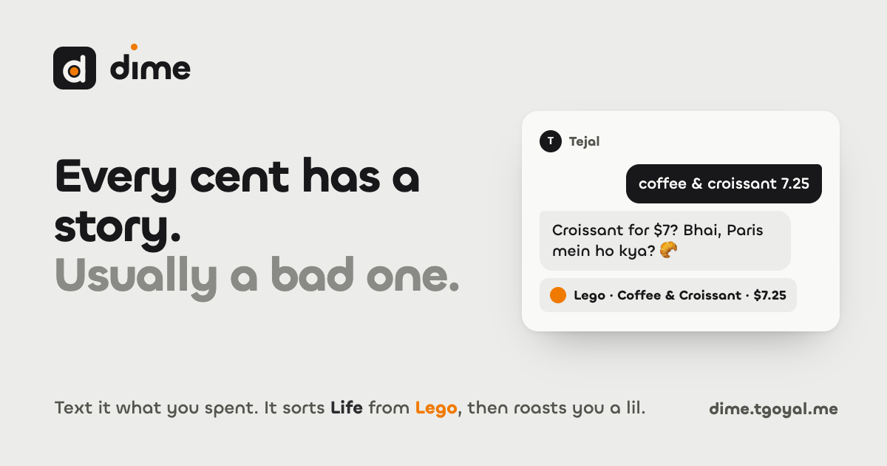

# Dime


An expense tracker you text like a friend. You tell it `coffee & croissant 7.25`, it files it under **Life** (you needed it) or **Lego** (you wanted it), keeps the receipt, and roasts you a little in Hinglish.

Every cent has a story. Usually a bad one.

**Live:** [dime.tgoyal.me](https://dime.tgoyal.me) (invite only. Don't have a code? Ask a friend. The friend is me.)



---

## Why I made this

Every budgeting app I tried wanted me to pick a category from a dropdown, at a checkout counter, with a coffee in one hand. I'm not doing that. I will, however, send a text.

So Dime is a chat. You type what you bought the way you'd say it, and it does the boring part. No forms, no dropdowns, no "select a subcategory".

It's the rewrite of [WalletRIP](https://github.com/tejalgoyal2/WalletRIP), my first attempt, which worked but wrote to the database straight from the browser. We don't talk about WalletRIP.

---

## What it does

**You text, it sorts.** `uber home 18`, `groceries at freshco 84`, `netflix 16.99`. It finds the price, picks a category, decides Life or Lego, and replies.

**Life vs Lego.** Rent, groceries, your phone bill: Life. Bubble tea, a third pair of white sneakers, that 2am pizza: Lego. Disagree? Tap the coin to flip it. Dime remembers, so next time coffee goes where you put it.

**Two numbers? It asks.** `got 310 airpods pro 34` is confusing even for humans. Dime highlights the price it thinks you meant and lets you tap the other one.

**Big spends get the cash bill.** Anything $50 and up gets a little green bill so future you knows exactly where it went.

**A dashboard you can rearrange.** Drag cards around, resize them, hide the ones you don't care about. Your layout follows you between devices.

- *How it's going*: bars, Life vs Lego lines, or a running total racing last month (and your budget, if you set one)
- *The receipt*: today's damage, printed
- *The seesaw*: Life and Lego, literally weighed against each other
- *Dime club*: a punch card for logging a few times a week (you pick how many, it's not a daily guilt trip)
- *The year*: a GitHub-style heatmap of your spending
- *Biggest hits*, *When you spend* (night-you is expensive), *Categories over time*, *Subscriptions*, *Weekdays*

**Read my month / Roast me.** One gives you an honest summary and one thing to try. The other gives you a performance review you didn't ask for. Don't speak Hinglish? Every roast has a **Translate** button.

**Money check-up.** A big card at the bottom with your vitals (this month's pace, how much is Lego, what's on repeat, what's creeping up, how much happens after 9pm), and three concrete moves for next month when you ask. I'm a friend with a spreadsheet, not a financial advisor, and the card says so.

**Search everything.** Hit ⌘K (Ctrl K on Windows) and type `coffee`. It tells you how many coffees you've bought and what they cost. You can also log from there.

**Six colour palettes, a real dark mode, and your own animal.** Pick a fox. Or a frog. I'm not your mom.

**It talks like a person.** Mostly like me at 1am. Try typing 67.

---

## Log from anywhere

Dime has a tiny API so you can log without opening the app: tap your phone to pay, forward a bank text, or ask Siri. It logs quietly and replies with nothing, the way a good friend takes a hint.

**Full setup (iPhone, Android and everything else): [docs/auto-log.md](docs/auto-log.md)**. Curious how the rest works? [docs/under-the-hood.md](docs/under-the-hood.md).

The short version:

1. In Dime, open your avatar menu → **Auto-log** → **Create a token**. Copy it. It's shown once.
2. Send it what you spent:

```bash
curl -X POST https://dime.tgoyal.me/api/ingest \
  -H "Authorization: Bearer dime_..." \
  -d "coffee & croissant 7"
```

That's the whole API. Plain text or `{"text": "..."}` both work. Bank alerts work too: OTPs, refunds and deposits get ignored, and the same alert forwarded twice only logs once.

---

## How it's built

| | |
|---|---|
| **App** | Next.js 16 (App Router), React 19, TypeScript strict |
| **Hosting** | Cloudflare Workers via [OpenNext](https://opennext.js.org/cloudflare) |
| **Database + auth** | Supabase (Postgres with row-level security) |
| **AI** | Google Gemini 3.5 Flash-Lite through the Gen AI SDK, with a fallback model |
| **Rate limiting** | Upstash Redis |
| **Validation** | Zod v4, same schemas on client and server |
| **Look and feel** | Tailwind v4, Framer Motion, dnd-kit, NumberFlow, cmdk, Sonner |
| **Type** | [Chillax](https://www.fontshare.com/fonts/chillax) |

The browser never writes to the database. Everything goes through API routes that check who you are, validate the input, and rate-limit you.

**Routes:** `/api/expenses`, `/api/parse`, `/api/insights`, `/api/roast`, `/api/advice`, `/api/analyze-subs`, `/api/signup`, `/api/ingest`, `/api/quick-add`, `/api/tokens`, `/api/preferences`, `/api/profile`

```
app/
  api/            the routes above
  login/          the chat you sign in through
components/
  dashboard/      the composer, the cards, the drawer, ⌘K, the trays
  dime/           chat bubbles and the typing dots
  ui/             pills, trays, money, the logo, the cash bill, animals
lib/
  ingest.ts       the auto-log pipeline
  life-lego.ts    how Life vs Lego gets decided, and remembered
  checkup.ts      the money check-up's vitals
  gemini.ts       every AI call goes through here
  amounts.ts      finding the price in what you typed
  rate-limit.ts   all the limits in one place
supabase/         SQL to run once (keep-alive table, dashboard + auto-log tables)
```

---

## Security, briefly

I'd like nobody to read your coffee habits, including me.

- **Accounts:** a name and a secret, no email, no phone. Sign-up happens on the server only after the invite code checks out. Forget your secret and I genuinely can't help. Everything has its settlements.
- **Your data:** row-level security, so every query only ever sees your rows.
- **Auto-log tokens:** stored as SHA-256 hashes, shown once, revocable any time.
- **Rate limits:** 20 requests a minute in the app, 30 a minute per IP and 12 a minute per token on the API, 300 AI calls per person per day. The IP comes from Cloudflare's own header, which can't be faked.
- **Headers:** a strict Content-Security-Policy, no framing, HSTS, nosniff.
- **AI:** your messages are treated as data, not instructions, and whatever comes back is validated before it's saved.
- **CSV export:** protected against spreadsheet formula injection.

---

## Run it yourself

```bash
git clone https://github.com/tejalgoyal2/Dime.git && cd Dime
npm install
cp .env.example .env.local   # every variable is explained in there
npm run dev
```

You'll need a [Supabase](https://supabase.com) project, a [Gemini API key](https://aistudio.google.com/apikey) and an [Upstash Redis](https://upstash.com) database. All free tiers.

Then, once, in the Supabase SQL editor: run `supabase/keepalive.sql` and `supabase/migrations/002_dashboard_autolog.sql`, and turn off **Authentication → Sign In / Providers → Allow new users to sign up** (Dime makes accounts itself, after the invite check).

```bash
npm run build      # production build
npm run build:cf   # Cloudflare build
npm run preview    # run the Cloudflare build locally
```

Pushing to `main` deploys to Cloudflare through GitHub Actions. A second workflow pokes Supabase every three days so the free project never falls asleep.

**Two Cloudflare Workers lessons that cost me hours:**

- Don't add `export const runtime = "edge"` to API routes. OpenNext already runs them at the edge, and the directive breaks them with a silent 500 and no stack trace.
- Read `process.env` inside functions, not at the top of a module. Workers fill env in late.

---

## Thanks

- Animal faces: [Fluent Emoji 3D](https://github.com/microsoft/fluentui-emoji) by Microsoft (MIT)
- Type: [Chillax](https://www.fontshare.com/fonts/chillax) by Indian Type Foundry

---

Made with too much coffee by [Tejal Goyal](https://tgoyal.me) · [LinkedIn](https://linkedin.com/in/tejalgoyal) · [Blog](https://tejalgoyal2.github.io)
